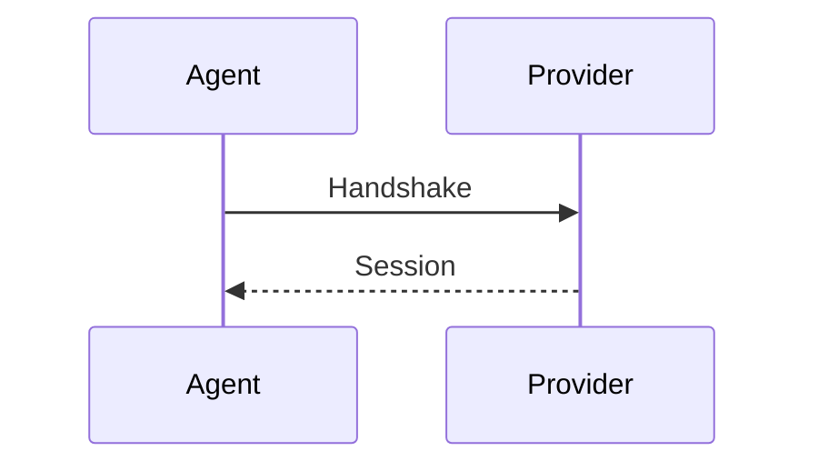

# Procedure player



The declaration version is derived from the enclosing `v0.1.0/` documentation
directory.

```stateforge-procedure
source: procedures/bootstrap.yaml
scenario: success
```

## Entity flow

```stateforge-entity-flow
source: trigger-flow.yaml
```

```python
from stateforge_docs_theme import __version__
```

<div class="sf-docs-lifecycle" data-sf-lifecycle data-prompt="Select a stage to play its exchange" aria-busy="false">
  <div class="sf-docs-lifecycle__exchange" aria-label="Fixture lifecycle exchange">
    <div class="sf-docs-lifecycle__actor" data-sf-flow-actor="source">
      <span>Source</span>
      <strong data-sf-flow-source-state>Publishes state</strong>
    </div>
    <div class="sf-docs-lifecycle__rail" aria-hidden="true">
      <span class="sf-docs-lifecycle__line"></span>
      <span class="sf-docs-lifecycle__packet" data-sf-flow-packet></span>
      <code class="sf-docs-lifecycle__message" data-sf-flow-message>state</code>
    </div>
    <div class="sf-docs-lifecycle__actor" data-sf-flow-actor="target">
      <span>Target</span>
      <strong data-sf-flow-target-state>Accepts state</strong>
    </div>
  </div>
  <p class="sf-docs-lifecycle__status" data-sf-flow-status aria-live="polite">Select a stage to play its exchange</p>
  <div class="sf-docs-flow">
    <button
      class="sf-docs-flow__step"
      type="button"
      data-sf-flow-step
      data-stage="publish"
      data-source-state="Publishes state"
      data-target-state="Accepts state"
      data-result="State accepted"
      data-events='[{"direction":"forward","label":"state","detail":"Publishing state"}]'
      aria-pressed="true"
    >
      <span class="sf-docs-flow__action" data-sf-flow-action aria-hidden="true">Replay</span>
      <span class="sf-docs-flow__number">01 / PUBLISH</span>
      <h3>Publish</h3>
      <p>Publish one state transition.</p>
    </button>
    <button
      class="sf-docs-flow__step"
      type="button"
      data-sf-flow-step
      data-stage="acknowledge"
      data-source-state="Awaits disposition"
      data-target-state="Acknowledges state"
      data-result="State acknowledged"
      data-events='[{"direction":"reverse","label":"acknowledgement","detail":"Acknowledging state"}]'
      aria-pressed="false"
    >
      <span class="sf-docs-flow__action" data-sf-flow-action aria-hidden="true">Play</span>
      <span class="sf-docs-flow__number">02 / ACKNOWLEDGE</span>
      <h3>Acknowledge</h3>
      <p>Return the disposition.</p>
    </button>
  </div>
</div>
